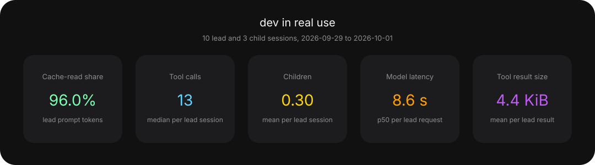

<p align="center">
  
</p>

<h1 align="center">dev</h1>

<p align="center">My personal agent distro built on top of <a href="https://github.com/earendil-works/pi">Pi</a>.</p>

## Why I made this

I wanted a terminal-first experience. I was a Hermes main, but I wanted to come back to the terminal, and its CLI was not that enjoyable. So I built the environment I wanted on Pi, which already owns inference, sessions and the TUI, and kept for myself only the parts Pi does not have.

## What it does

- **`dev`** opens Pi from the project you are working on, with a profile that selects guidance and skills, and keeps private state out of the project and out of Git. [launcher](docs/launcher.md)
- **`work`** runs commands and delegated Pi children in the background, in separate processes, with version-controlled model dispatch and outcomes delivered back into the conversation. [work](docs/work.md), [dispatch](config/README.md)
- **`workspace`** lets several sessions and their children write to one repository without overwriting each other, allocating worktrees when needed and releasing them once the work is delivered. [workspace](docs/workspace.md)
- **`read_url`** gives the lead and children sourced page text, using an authenticated Chrome profile copy when needed. Pi's native codemode can compose reads in scripts. [read URL](docs/web-read.md)
- **Background compaction** prepares long-session summaries while the lead and children keep working. [compaction](docs/compaction.md)

The component map and decision-record index are in [ARCHITECTURE](docs/ARCHITECTURE.md). What dev trusts and what it does not protect: [SECURITY](SECURITY.md).

## Use dev

Read [SECURITY](SECURITY.md) before installing.

### Install

On a new Mac, one command sets everything up:

```bash
curl -fsSL https://raw.githubusercontent.com/taekwondodev/dev/main/scripts/install.sh | sh
```

It first checks Node, the Xcode Command Line Tools, `git` and that npm can link the `dev` command without sudo, and stops before changing anything if one is missing. Then it installs the latest Pi with the [pi.dev installer](https://pi.dev), clones dev's `main` into `${XDG_DATA_HOME:-~/.local/share}/dev` (`DEV_DIR` overrides the path), runs the manual steps below in it, and installs [dev-footer](https://github.com/taekwondodev/dev-footer), [dev-header](https://github.com/taekwondodev/dev-header), [dev-hush](https://github.com/taekwondodev/dev-hush) and [terminal-status-title](https://github.com/taekwondodev/terminal-status-title) as global Pi packages. It asks before installing `npm:pi-claude-bridge`. Last, it copies the [skill library](https://github.com/taekwondodev/skills) into `~/.agents/skills`; if a skill name is already there, it copies none and lists the collisions.

Everything comes from `main` and Pi's latest release. Afterwards `npm run update` in the checkout updates dev and Pi, and `pi update --extensions` updates the extensions. The installer does not run over an existing checkout and does not update the copied skills.

### Install by hand

Prerequisites:

- `pi` installed with the [pi.dev installer](https://pi.dev)
- Optional: the skill library at `~/.agents/skills`
- Node satisfying `package.json`, with SQLite's [WAL-reset fix](https://www.sqlite.org/wal.html#the_wal_reset_bug)
- The Xcode Command Line Tools, for the native addon

From a clone of this repository:

```bash
npm ci
npm run setup
npm link --ignore-scripts
```

dev starts with its default profile, `config/default-profiles.json`. To customize, write `profiles/manifest.json`, which Git ignores; it names each profile's guidance and skill directories and replaces the default. The format is in the [launcher guide](docs/launcher.md#profiles-and-resources).

Then, from any Git project:

```bash
cd /path/to/your/project
dev
```

## Documentation

| Task                                                    | Start here                             |
| ------------------------------------------------------- | -------------------------------------- |
| Launch, select a profile or resume                      | [Launcher](docs/launcher.md)           |
| Run background commands or delegate                     | [Work](docs/work.md)                   |
| Inspect retained work and release worktrees             | [Workspace](docs/workspace.md)         |
| Read documentation URLs, manage the Chrome profile copy | [Read URL](docs/web-read.md)           |
| Understand long-session context handling                | [Compaction](docs/compaction.md)       |
| Read private metrics, export charts or a conversation   | [Usage profile](docs/usage-profile.md) |
| Upgrade Pi and dev's dependencies                       | [Upgrade](docs/upgrade.md)             |
| Change dev's code                                       | [Development](docs/DEVELOPMENT.md)     |
| Find components and decision records                    | [Architecture](docs/ARCHITECTURE.md)   |
| Look up domain terms                                    | [CONTEXT](CONTEXT.md)                  |

Agent contributors start from [AGENTS.md](AGENTS.md); the [security model](SECURITY.md) applies to every integration.

## Performance

Measured on my own use of dev, not on benchmarks: every lead and child session file in my data home, abandoned branches included. Each chart names its sample size and date range.

<p align="center">
  
</p>

The [metric definitions](docs/usage-profile.md#read-the-results) explain what these charts establish, including why tool success is not task correctness. To regenerate the committed charts, follow [export for publication](docs/usage-profile.md#export-for-publication); private reports and drilldowns are not public exports.
